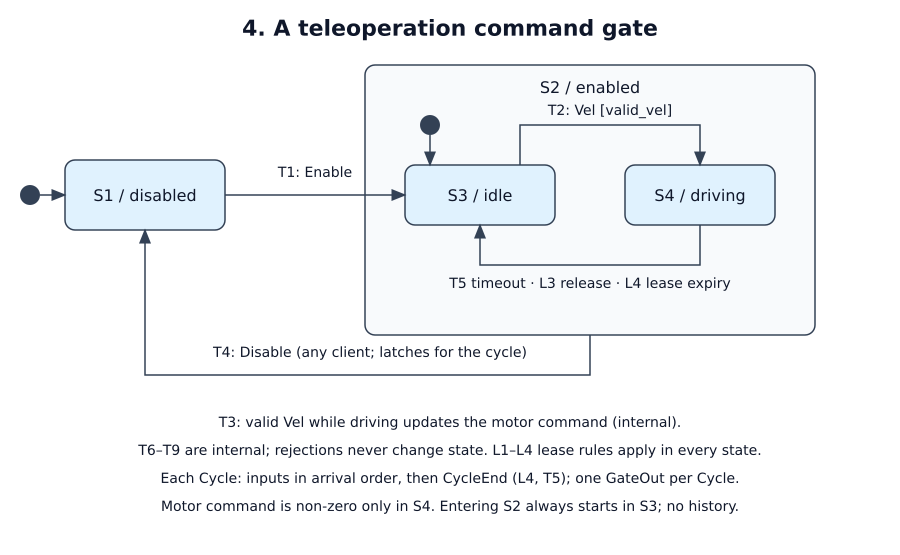

# A teleoperation command gate

Status: tutorial specification. A proof-of-concept implementation of this
revision passed A1–A8 on 2026-10-18 (msrs 9528ecf, cu29 =1.0.0-rc2, statig
0.4.1). That code is not shipped with the skill; for your implementation, the
A-cases are planned tests.

## Purpose and boundary

Gate teleoperation velocity commands from one lease-holding client to a motor
driver. Topology: teleop clients → Unix socket → cycle producer → gate → motor
driver and status consumer, all on the robot computer. Out of scope: trajectory
generation, odometry and braking. The driver has its own independent watchdog:
zero output 50 ms after its last command. The driver owns that guarantee, and
it covers this process stopping.

## Authority and invariants

One client at a time holds the lease. Only the holder's velocity commands can
move the robot. Any client may send Disable; stopping requires no authority.

| ID | Invariant or required outcome | Applies when | Evidence |
|----|-------------------------------|--------------|----------|
| R1 | Motor command is exactly zero in every cycle whose resulting state is not S4 | always | A2, A3, A5, A8 |
| R2 | Exactly one `GateOut` per cycle, including cycles with no events | always | A1, A6 |
| R3 | A velocity from a non-holder, or while disabled, or that is duplicate, non-finite, out of range, future-dated or stale, is rejected and never applied | always | A4 |
| R4 | S4 ends in the first cycle with `now - last_applied ≥ watchdog`; motor zero in that cycle | S4 | A5 |
| R5 | A Disable anywhere in a cycle's batch makes that cycle's output disabled and zero; a later Enable in the same batch is rejected | always | A3 |
| R6 | Input traffic cannot suppress cycles; the watchdog runs under sustained input | always | A7 |
| R7 | Cold start: disabled, no holder, zero command from the first cycle | startup | A6 |

"Disabled" means this service commands zero velocity. It does not remove motor
power; the physical stop belongs to the driver.

## Configuration

| Name | Value | Units / range | Changed by / when |
|------|-------|---------------|-------------------|
| cycle period | 10 nominal, 20 max gap | ms | compiled in (`rate_target_hz: 100`) |
| watchdog | 200 | ms since last applied velocity | compiled in |
| max command age | 100 | ms, `now_ns - sent_ns` | compiled in |
| lease idle expiry | 1000 | ms since holder's last accepted event | compiled in |
| vx limit | 1.0 | m/s, magnitude; reject, never clamp | compiled in |
| wz limit | 2.0 | rad/s, magnitude; reject, never clamp | compiled in |
| batch capacity | 32 | events per cycle | compiled in |

## Interfaces and data semantics

| ID | Direction / peer | Meaning and fields | Delivery contract |
|----|------------------|--------------------|-------------------|
| I1 | in / client | `Enable{client}`, `Disable{client}`, `Acquire{client}`, `Release{client}`, `Vel{client, seq, vx, wz, sent_ns}` | Line protocol on one Unix socket; arrival order preserved; malformed lines are answered `error parse` by the transport and never enter the DAG |
| I2 | in / producer → gate | `Cycle{now_ns, events (≤ capacity, arrival order), dropped}` | One per runtime iteration; the batch is taken before `now_ns` is sampled |
| I3 | out / driver, consumer | `GateOut{motor{vx, wz}, state, holder, reason, rejected[{index, reason}]}` | One per cycle; `motor` is the only actuating field |

Clock: `CLOCK_MONOTONIC` on the robot computer, in nanoseconds. Same-host
clients and the producer share it. `sent_ns` is the client's send time; teleop
has no separate acquisition time. `client` is a u32 chosen by the client, with
no authentication (see open decisions). `seq` increases per client. Overflow
beyond capacity drops the newest events of that cycle and counts them in
`dropped`. Velocities are finite f32 values.

## Behavior

[Editable draw.io source](behavior.drawio)

Legend: filled dots mark the initial leaf and the composite's default entry.
The `enabled` rectangle is a superstate. T4 leaves it from either child. Notes
list internal transitions and data rules that the drawing does not draw.

| State ID / name | Meaning and invariant | Entry / exit effects |
|-----------------|-----------------------|----------------------|
| S1 / disabled | Initial leaf; motor zero | Entry: clear motor and `last_applied` |
| S2 / enabled | Composite of S3, S4; default entry S3; no history | none |
| S3 / idle | Enabled, motor zero | none |
| S4 / driving | Enabled, motor = last applied velocity | none |

| ID | Source | Event | Guard | Target | Ordered effects |
|----|--------|-------|-------|--------|-----------------|
| T1 | S1 | Enable | not latched this cycle | S3 | — |
| T2 | S3 | Vel | `valid_vel` | S4 | apply velocity; record seq and time |
| T3 | S4 | Vel | `valid_vel` | S4, internal | apply velocity; record seq and time |
| T4 | S2, either leaf | Disable | — | S1 | latch disable for the rest of the cycle |
| T5 | S4 | CycleEnd | `now - last_applied ≥ watchdog` | S3 | motor zero; reason `timeout` |
| T6 | S1 | Disable | — | S1, internal | latch |
| T7 | S1 | Enable | latched | S1, internal | reject `disable_latched` |
| T8 | S1 | Vel | — | S1, internal | reject `disabled` |
| T9 | S2, either leaf | Enable | — | same leaf, internal | none |
| L1 | any | Acquire | no holder, or holder = client | same | holder := client; reset seq baseline if the holder changed |
| L2 | any | Acquire | holder ≠ client | same | reject `not_holder` |
| L3 | any | Release | holder = client | same; S4 → S3 | holder := none; motor zero |
| L4 | any | CycleEnd | holder idle ≥ lease expiry | same; S4 → S3 | holder := none; reason `lease_expired` |

`valid_vel` checks, in order: client is holder; `seq` > last applied `seq`; vx
and wz finite; within limits; `sent_ns ≤ now_ns`; `now_ns - sent_ns` < max age.
The first failing check is the rejection reason (`not_holder`, `duplicate`,
`non_finite`, `out_of_range`, `future`, `stale`). Release from a non-holder is
rejected `not_holder`. Rejections never change state or refresh the lease.
L3 and L4 have leaf-specific effects in S4, so the S4 handler implements them
there; the top superstate implements them for the other leaves. Every input has
a defined result; none is silently ignored.

## Ordering and time

One `Cycle` is one logical step:

1. If `now_ns` is less than the previous cycle's, apply Disable (latching),
   clear the lease, and set reason `clock_fault`. If `dropped > 0`, set
   reason `overflow`.
2. Apply events in arrival order. A Disable latch lasts until the end of this cycle.
3. Apply the internal `CycleEnd` at `now_ns`: L4, then T5.
4. Build `GateOut` from the resulting state.

A valid Vel in the cycle where the watchdog boundary falls refreshes
`last_applied` before T5 runs, so no timeout occurs. Equal `now_ns` across
cycles is valid. Reason precedence for one cycle: `clock_fault` > `overflow` >
`timeout` > `lease_expired` > none.

| Requirement | Bound / clock / measurement points | On violation |
|-------------|------------------------------------|--------------|
| Cycle gap | ≤ 20 ms between consecutive recorded `now_ns` | reported from the log; supervisor policy in production |
| Step budget | gate `process_time` ≤ 1 ms | reported from the log |
| Disable → zero | zero in the cycle carrying Disable: ≤ 20 ms + step after arrival | — |
| Watchdog → zero | ≤ 20 ms after the deadline | — |

## Failure, recovery and lifecycle

| Condition | Detection / owner | Required state and outputs | Recovery / reset authority |
|-----------|-------------------|----------------------------|----------------------------|
| Client disconnect | transport | no direct output; L4 and T5 follow | reconnect and Acquire |
| Batch overflow | producer | reason `overflow`; dropped events never applied | automatic |
| Backward clock | gate | S1, zero, no holder, reason `clock_fault` | Enable and Acquire |
| Task panic or process crash | supervisor; driver watchdog | driver zeroes within 50 ms | restart cold (R7) |
| SIGINT or SIGTERM | runtime | tasks stopped, log flushed, exit 0 | supervisor |

Nothing persists. A restart is cold; clients must Enable and Acquire again.

## Deployment and operations

Supervised by systemd with a fixed working directory for crash reports. The
loop runs at 100 Hz. The log uses a 64 MiB slab; about 600 B per copperlist
× 100 Hz is about 0.2 GB/h, with retention handled by deployment. The socket
path is configured at startup, and a stale socket is removed at bind. Pins:
msrs 9528ecf, cu29 =1.0.0-rc2, statig =0.4.1.

## Implementation mapping and capability gaps

A service-owned producer source task batches I1 and samples `CLOCK_MONOTONIC`
after the take. It feeds `FsmTask<GateMachine>`, then `EgressTask<GateOut>`.
The producer emits every iteration, so `Tick` never occurs and the watchdog is
the internal `CycleEnd` event. One composite output avoids the single-emit
limit. statig superstate `enabled` handles T4/T9; a top superstate handles
lease rules. Reported state is derived from the statig state, which makes R1
true by construction. No msrs changes are required.

## Observability and replay

The log records every `Cycle` and `GateOut`. Replay feeds recorded cycles to a
cold machine and requires equal outputs for every copperlist. It reports the
first divergence, checks for copperlist ID gaps, and must fail a perturbed
initial state. Timing evidence comes from the same log: `now_ns` gaps, gate
`process_time`, latency from the last applied Vel to T5, and same-cycle Disable.

## Acceptance scenarios

All times are in milliseconds; encode them as nanoseconds.

| ID / requirements | Given | When (ordered inputs and times) | Then | Evidence level |
|-------------------|-------|---------------------------------|------|----------------|
| A1 / R2 | cold | three empty cycles | three outputs: disabled, zero, no holder | unit |
| A2 / R1, T1, T2, L1 | cold | 0: Enable; 10: Acquire(1); 20: Vel(1, seq 1, 0.5) | S3, S3 with holder 1, then S4 with motor 0.5 | unit |
| A3 / R5, T4, T7, T8 | S4 | one cycle: Vel, Disable, Enable, Vel | S1, zero; index 2 `disable_latched`; index 3 `disabled`; next cycle Enable is accepted | unit |
| A4 / R3 | S4, holder 1, at 150 | Vel from 2; sent at 40; NaN; vx 1.5; old seq; sent at 151; Acquire(2); Release(2) | each rejected with its listed reason, in index order; motor unchanged | unit |
| A5 / R4, T5 | S4 at 0 | cycles at 190, 200 − 1 ns, 200 | S4, S4, then S3 with zero and `timeout`; lease kept | unit |
| A6 / R7 | restart | first cycle | disabled, zero, no holder | unit and daemon |
| A7 / R6 | daemon | 1 kHz Vel stream for 5 s, then stop | max gap ≤ 20 ms; T5 within 220 ms of the last applied Vel; replay equal | daemon and log |
| A8 / R1, T4 | S3; separately S4 | Disable | S1 and zero from both | unit |

Additional checks: an exhaustive leaf × event table, a seeded randomized trace
checking R1/R5 and limits, a replay negative control, and SIGTERM exit 0.

## Open decisions

| Decision / assumption | Owner | Blocks implementation? | Resolution / evidence needed |
|-----------------------|-------|------------------------|------------------------------|
| Client identity is self-declared | robot owner | no for tutorial; yes for production | authenticated transport identity |
| Overflow drops newest events, which may include a Disable | robot owner | yes for production | give Disable a reserved slot or a separate channel |
