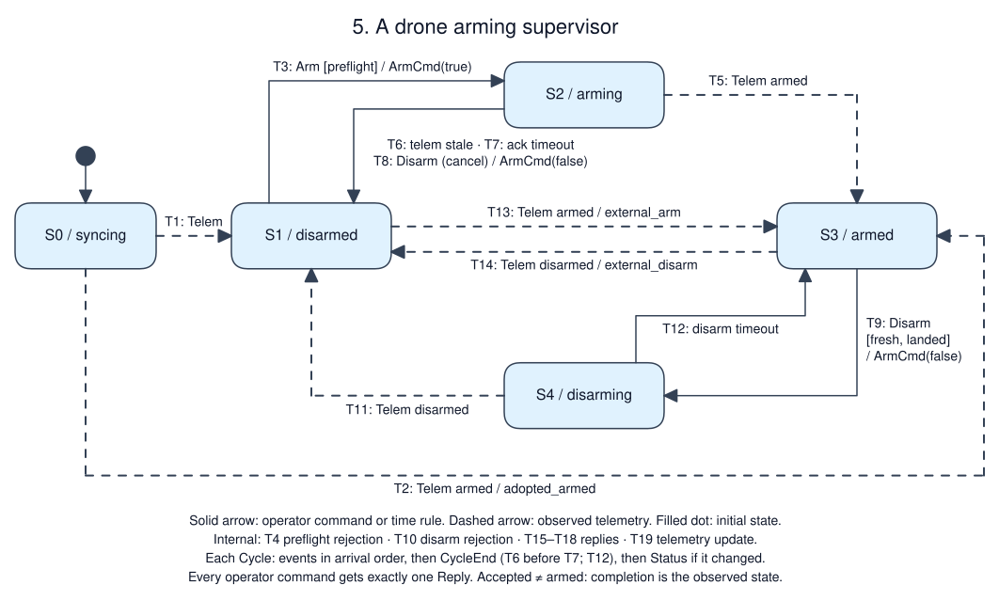

# A drone arming supervisor

Status: tutorial specification. A reference implementation of this revision
passed A1–A13, including the daemon scenario and replay gate, on 2026-10-18
(msrs a1a8370, cu29 =1.0.0-rc2, statig =0.4.1). That code is not shipped with
the skill; for your implementation, the A-cases are planned tests.

## Purpose and boundary

Own the arm/disarm request from an operator to one drone's flight controller
(the autopilot). Topology: operator client → Unix socket → this service ↔
autopilot link; all on the companion computer. The service decides whether a
request may be sent; the autopilot decides whether the motors are armed. Out of
scope: flight modes, takeoff, the RC kill switch, and the autopilot's own
failsafes (auto-disarm after landing, link-loss behavior), which the autopilot
owns and which keep working if this process stops.

## Authority and invariants

This service is the only software path that requests arming. The autopilot's
reported state is authoritative for whether the motors are armed. The service
reports three things separately: what the operator asked (reply), what it
requested (`ArmCmd`) and what the autopilot reports (observed state).

| ID | Invariant or required outcome | Applies when | Evidence |
|----|-------------------------------|--------------|----------|
| R1 | `ArmCmd(true)` is sent only by T3, so only when every preflight check passes at that event | always | A3, A4, A9 |
| R2 | `ArmCmd(false)` is sent only while the latest telemetry reports disarmed (cancelling a pending arm), or reports landed and is fresh | always | A5, A7, A10 |
| R3 | Every operator command gets exactly one `Reply`, in the cycle in which it is drained, in arrival order | always | A3, A4, A11 |
| R4 | An arm request ends no later than the first cycle with `now - requested_at ≥ arm_ack_timeout`: in S3 if the autopilot reported armed, otherwise in S1 with `ArmCmd(false)` | S2 | A5, A10 |
| R5 | The service never commands against observed state. Telemetry that disagrees with S0, S1 or S3 moves the service to the observed state | always | A2, A6, A8 |
| R6 | Cold start is S0 with no command output; telemetry is adopted, not overridden | startup | A1, A8 |
| R7 | One `Status` in the first cycle, then one exactly when its content changes; at most one per cycle, after the cycle's other outputs | always | A1, A3 |

A disarm request to an airborne autopilot stops the motors. R2 is the reason
this service never sends one in response to an operator command unless fresh
telemetry reports landed.

## Configuration

| Name | Value | Units / range | Changed by / when |
|------|-------|---------------|-------------------|
| cycle period | 20 nominal | ms (`rate_target_hz: 50`) | compiled in |
| telemetry stale | 500 | ms since the cycle that drained the last telemetry | compiled in |
| arm ack timeout | 1000 | ms since T3 | compiled in |
| disarm ack timeout | 1000 | ms since T9 | compiled in |
| minimum battery | 30 | percent, inclusive | compiled in |
| batch capacity | 32 | events per cycle (`max_batch`) | compiled in |

## Interfaces and data semantics

| ID | Direction / peer | Meaning and fields | Delivery contract |
|----|------------------|--------------------|-------------------|
| I1 | in / operator | `Arm{id}`, `Disarm{id}`; `id` is a u64 chosen by the client | Line protocol on one Unix socket; arrival order preserved; malformed lines are answered `error parse` by the transport and never enter the DAG |
| I2 | in / autopilot | `Telem{armed, landed, battery_pct, gps_ok}` at about 10 Hz | Latest-value semantics; `battery_pct` is 0–100 (the link rejects other values); no autopilot timestamp is used |
| I3 | out / autopilot | `ArmCmd{arm}` | A request, not a state; the autopilot may refuse or ignore it. No resend |
| I4 | out / operator | `Reply{id, result}`, `result` ∈ `Accepted`, `NoChange`, `Rejected(reason)` | Acceptance only. `Accepted` means a request was sent or cancelled; completion is reported by `Status` |
| I5 | out / operator | `Status{state, armed, landed, battery_pct, telem_fresh, reason, backlog}` | Sent on change (R7). `armed`/`landed`/`battery_pct` are `None` before the first telemetry; `backlog` is true when events were left queued |

Clock: cu29's `RobotClock`, read by `CycleIngressTask` after it drains a batch.
Every event drained in a cycle is treated as received at that cycle's `now_ns`.
No peer timestamps are compared with it, so a process-local clock suffices.
A backlog would make telemetry look younger than it is; `backlog` reports it.

## Behavior

[Editable Excalidraw source](behavior.excalidraw)

Legend: the filled dot is the initial state. Solid arrows are transitions
caused by operator commands or by time; dashed arrows are transitions caused by
observed telemetry. Internal rules are listed under the drawing.

| State ID / name | Meaning and invariant | Entry / exit effects |
|-----------------|-----------------------|----------------------|
| S0 / syncing | No telemetry since start; commands rejected | none |
| S1 / disarmed | Autopilot reports disarmed; no request pending | none |
| S2 / arming | `ArmCmd(true)` sent; latest telemetry still reports disarmed | Entry: `requested_at := now` |
| S3 / armed | Autopilot reports armed; no request pending | none |
| S4 / disarming | `ArmCmd(false)` sent; latest telemetry still reports armed | Entry: `requested_at := now` |

| ID | Source | Event | Guard | Target | Ordered effects |
|----|--------|-------|-------|--------|-----------------|
| T1 | S0 | Telem | not armed | S1 | record telemetry |
| T2 | S0 | Telem | armed | S3 | record telemetry; reason `adopted_armed` |
| T3 | S1 | Arm | `preflight` passes | S2 | `Reply Accepted`; `ArmCmd(true)` |
| T4 | S1 | Arm | `preflight` fails | S1, internal | `Reply Rejected(first failing check)` |
| T5 | S2 | Telem | armed | S3 | record telemetry; reason `armed` |
| T6 | S2 | CycleEnd | telemetry stale | S1 | `ArmCmd(false)`; reason `telem_lost` |
| T7 | S2 | CycleEnd | `now - requested_at ≥ arm_ack_timeout` | S1 | `ArmCmd(false)`; reason `arm_timeout` |
| T8 | S2 | Disarm | — | S1 | `Reply Accepted`; `ArmCmd(false)`; reason `cancelled` |
| T9 | S3 | Disarm | telemetry fresh and landed | S4 | `Reply Accepted`; `ArmCmd(false)` |
| T10 | S3 | Disarm | stale, or airborne | S3, internal | `Reply Rejected(telem_stale \| airborne)`, in that order |
| T11 | S4 | Telem | not armed | S1 | record telemetry; reason `disarmed` |
| T12 | S4 | CycleEnd | `now - requested_at ≥ disarm_ack_timeout` | S3 | reason `disarm_timeout` |
| T13 | S1 | Telem | armed | S3 | record telemetry; reason `external_arm` |
| T14 | S3 | Telem | not armed | S1 | record telemetry; reason `external_disarm` |
| T15 | S2, S3 | Arm | — | same, internal | `Reply NoChange` |
| T16 | S1, S4 | Disarm | — | same, internal | `Reply NoChange` |
| T17 | S4 | Arm | — | S4, internal | `Reply Rejected(disarming)` |
| T18 | S0 | Arm, Disarm | — | S0, internal | `Reply Rejected(no_telemetry)` |
| T19 | any | Telem | none of the above | same, internal | record telemetry |

`preflight` checks, in order: telemetry fresh (`telem_stale`), landed
(`airborne`), `battery_pct ≥ minimum` (`battery_low`), `gps_ok` (`no_gps`).
"Fresh" means `now - last_telem_at < telemetry stale`, where `last_telem_at` is
the `now_ns` of the cycle that drained the latest telemetry. Telemetry drained
earlier in the same cycle counts. A late `armed` report after T6, T7 or T8 is
handled by T13: the service adopts it rather than fighting the autopilot.
`reason` in Status is the cause of the most recent transition into the current
state, `none` at startup; T1, T3 and T9 set it to `none`.

## Ordering and time

One `Cycle` is one logical step:

1. Events in arrival order. Telemetry updates observed state at its position,
   so a command is checked against the telemetry drained before it.
2. The internal `CycleEnd` at `now_ns`: in S2, T6 then T7; in S4, T12.
3. `Status`, if its content differs from the last one sent.

Outputs leave in the order they occur: replies and `ArmCmd`s during step 1 and
2, then `Status`. T6 takes precedence over T7 in the same cycle. Equal or
backward `now_ns` cannot occur: the cu29 clock is monotonic within a process.

| Requirement | Bound / clock / measurement points | On violation |
|-------------|------------------------------------|--------------|
| Reply latency | in the cycle that drains the command: ≤ one cycle period + step after arrival | — |
| Arm request bound | S2 ends within `arm_ack_timeout` + one cycle period | — |
| Step budget | FSM `process_time` ≤ 1 ms | reported from the log |

## Failure, recovery and lifecycle

| Condition | Detection / owner | Required state and outputs | Recovery / reset authority |
|-----------|-------------------|----------------------------|----------------------------|
| Autopilot ignores an arm request | T7 | S1, `ArmCmd(false)`, `arm_timeout` | operator retries |
| Telemetry stops | freshness rule | S2 → S1 with `telem_lost`; otherwise `telem_fresh = false` and commands rejected; no state change | telemetry resumes |
| Operator disconnects | transport | none; the service holds its state | reconnect |
| Process crash or restart | supervisor | autopilot keeps its state and failsafes; restart in S0, then adopt telemetry (R6) | automatic |
| SIGINT or SIGTERM | runtime | tasks stopped, log flushed, exit 0 | supervisor |

Nothing persists. A restart while airborne adopts `armed` from the first
telemetry and sends nothing.

## Implementation mapping and capability gaps

Stock adapters only: `CycleIngressTask<Inbound>` (`max_batch: 32`) →
`FsmBatchTask<ArmMachine>` → `BatchEgressTask<Outbound>`. `Inbound` is
`Op(OpCmd)` or `Telem(Telem)`; `Outbound` is `Autopilot(ArmCmd)`,
`Reply(Reply)` or `Status(Status)`. The transport routes outbound values to the
autopilot link or the operator socket. `backlog` is `Cycle::pending > 0`.
The flat statig machine has one handler per state; preflight is a pure store
query returning the first failing check. Reported state comes from the statig
state. No msrs changes are required.

## Deployment and operations

Supervised by systemd with a fixed working directory. 50 Hz loop; log slab
16 MiB; retention handled by deployment. Socket path from the command line;
a stale socket is removed at bind.

## Observability and replay

The log records every `Cycle` and the outputs of every step. Replay feeds the
recorded cycles to a cold machine and requires identical output batches,
including empty ones, for every copperlist. It reports the first divergence,
checks copperlist IDs are contiguous, and must fail when one recorded
telemetry value is perturbed.

## Acceptance scenarios

Times are milliseconds; encode them as nanoseconds. "Telem ok" means armed
false, landed, battery 90, gps ok.

| ID / requirements | Given | When (ordered inputs and times) | Then | Evidence level |
|-------------------|-------|---------------------------------|------|----------------|
| A1 / R6, R7 | cold | empty cycles at 0, 20, 40 | one `Status(S0)` at 0; nothing else | unit |
| A2 / T1, R5 | cold | 0: Telem ok | `Status(S1)` | unit |
| A3 / T3, T5, R3, R7 | S1, fresh | 100: Arm(1); 400: Telem armed | at 100: `Reply(1, Accepted)`, `ArmCmd(true)`, `Status(S2)`; at 400: `Status(S3, armed)` | unit |
| A4 / T4, R1 | S1 | Arm with telemetry age 500; age 499; battery 29; battery 29 and no gps; no gps | `telem_stale`; accepted; `battery_low`; `battery_low`; `no_gps` | unit |
| A5 / T7, R2, R4 | S2 at 100, telemetry fresh and disarmed | cycles at 1100 − 1 ns, 1100 | S2; then S1 with `ArmCmd(false)` and `arm_timeout` | unit |
| A6 / T13, R5 | after A5 | Telem armed | S3, `external_arm`; no `ArmCmd` | unit |
| A7 / T9, T10, T11, R2 | S3, airborne | Disarm(2); Telem armed and landed; Disarm(3); Telem disarmed | `Rejected(airborne)`, no ArmCmd; `Accepted`, `ArmCmd(false)`, S4; S1 `disarmed` | unit |
| A8 / T2, R5, R6 | cold | Telem armed, airborne | S3, `adopted_armed`; no `ArmCmd` | unit |
| A9 / R1, ordering | S1, battery 90 | one cycle [Telem battery 20, Arm(4)]; reset; one cycle [Arm(5), Telem battery 20] | Arm(4) `battery_low`; Arm(5) accepted | unit |
| A10 / T6, R4 | S2 at 100, last telemetry at 100 | cycles at 599, 600 | S2; then S1, `ArmCmd(false)`, `telem_lost` | unit |
| A11 / T15, R3 | S2 | Arm(6) | `Reply(6, NoChange)`; no second `ArmCmd` | unit |
| A12 / T12 | S4 at 0, telemetry armed | cycle at 1000 | S3, `disarm_timeout` | unit |
| A13 / all | daemon with simulated autopilot | arm, disarm, then arm with the autopilot ignoring requests | accepted → armed → disarmed; then `arm_timeout`; SIGTERM exits 0; replay equal; negative control fails | daemon and log |

Additional checks: an exhaustive state × event table (5 states × Arm, Disarm,
Telem armed/disarmed, CycleEnd) asserting exactly one reply per command and R1/R2.

## Open decisions

| Decision / assumption | Owner | Blocks implementation? | Resolution / evidence needed |
|-----------------------|-------|------------------------|------------------------------|
| No resend of an `ArmCmd` lost on the link | robot owner | no; T7 bounds the wait | use the autopilot's command acknowledgement if the link provides one |
| Operator identity is not authenticated | robot owner | no for tutorial; yes for production | authenticated transport |
