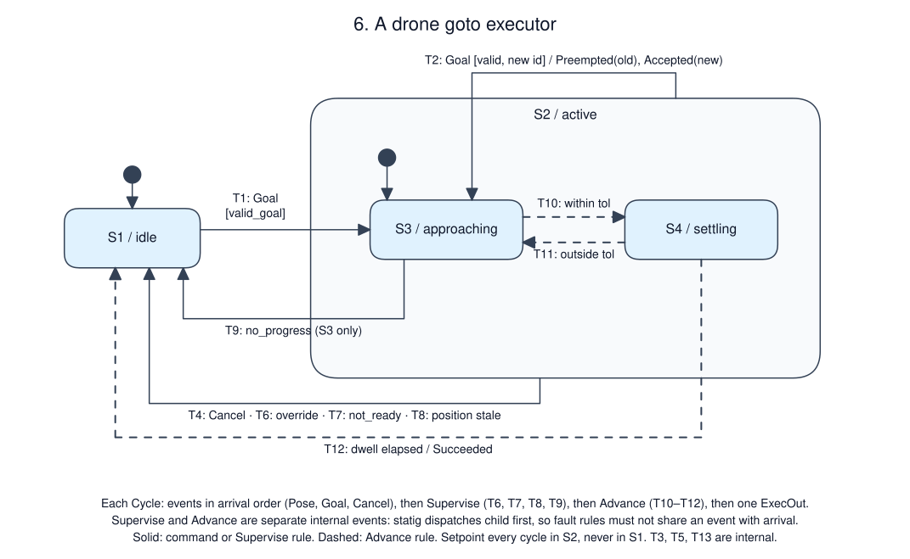

# A drone goto executor

Status: tutorial specification. A reference implementation of this revision
passed A1–A11, including the daemon scenario and replay gate, on 2026-10-18
(msrs a1a8370, cu29 =1.0.0-rc2, statig =0.4.1). That code is not shipped with
the skill; for your implementation, the A-cases are planned tests.

## Purpose and boundary

Fly an armed, airborne drone to one target position at a time and report how
each goal ends. Topology: mission client → Unix socket → this service →
autopilot position target; autopilot pose → this service; all on the companion
computer. The autopilot is in its `guided` mode, which follows a streamed
position target and holds position when the stream stops. Out of scope:
arming (example 05), takeoff, path planning and obstacle avoidance. The
autopilot owns attitude control, speed limiting and its own failsafes.

## Authority and invariants

The pilot's RC mode switch has authority over this service: leaving `guided`
ends the goal and this service stops streaming. One goal is active at most; a
new valid goal preempts it. The autopilot's pose is the authoritative position.

| ID | Invariant or required outcome | Applies when | Evidence |
|----|-------------------------------|--------------|----------|
| R1 | Every accepted goal ends with exactly one terminal event: `Succeeded`, `Canceled`, `Preempted` or `Aborted(reason)`; nothing follows it for that goal | always | A2, A4, A5, A6, A7 |
| R2 | Every `Goal` gets `Accepted` or `Rejected`, and every `Cancel` gets `Canceled` or `CancelRejected`, in the cycle it is drained | always | A2, A3, A5 |
| R3 | A setpoint is output in every cycle whose resulting state is in S2, and in no other cycle; it is the active goal's target and speed | always | A1, A2, A6 |
| R4 | `Succeeded` only after the latest fresh position has stayed within the arrival tolerance for at least the dwell time, measured with cycle times | S2 | A2, A8 |
| R5 | A rejected goal does not change an active goal | S2 | A3 |
| R6 | Leaving `guided` ends the goal in the same cycle, with no setpoint in that cycle | S2 | A6 |
| R7 | A goal outside the geofence is never accepted | always | A3 |
| R8 | Every goal ends within the progress window after its last 0.5 m of progress | S3 | A7 |

## Configuration

| Name | Value | Units / range | Changed by / when |
|------|-------|---------------|-------------------|
| cycle period | 20 nominal | ms (`rate_target_hz: 50`) | compiled in |
| position stale | 300 | ms since the cycle that drained the last valid pose | compiled in |
| arrival tolerance | 0.5 | m, 3-D distance, inclusive | compiled in |
| dwell | 1000 | ms within tolerance | compiled in |
| progress window / step | 5000 / 0.5 | ms / m of distance reduction | compiled in |
| geofence | radius 100 horizontal; altitude 2–50 | m from home, inclusive | compiled in |
| speed | (0, 5] | m/s | per goal |
| batch capacity | 32 | events per cycle | compiled in |

## Interfaces and data semantics

| ID | Direction / peer | Meaning and fields | Delivery contract |
|----|------------------|--------------------|-------------------|
| I1 | in / client | `Goal{goal_id, x, y, z, speed}`, `Cancel{goal_id}` | Line protocol on one Unix socket, arrival order preserved; malformed lines answered `error parse` by the transport |
| I2 | in / autopilot | `Pose{x, y, z, guided, armed, landed}` at about 20 Hz | Latest value. A pose with a non-finite coordinate is discarded: it does not update position or freshness |
| I3 | out / autopilot | `Setpoint{x, y, z, speed}` | Streamed every cycle while S2; the autopilot holds when the stream stops |
| I4 | out / client | `GoalEvent`: `Accepted`, `Rejected(reason)`, `Preempted`, `Succeeded`, `Canceled`, `CancelRejected`, `Aborted(reason)`, each with `goal_id` | In occurrence order within a cycle |
| I5 | out / client | `Active{goal_id, distance_m, settling}` | Every cycle in S2 |

Frame: local ENU in metres with its origin at the home position; `z` is height
above home. All positions in this service use that frame; the autopilot
converts. `goal_id` is a u64 chosen by the client. Clock: cu29 `RobotClock`
via `CycleIngressTask`; events are treated as received at their cycle's
`now_ns`. No peer timestamps are compared.

## Behavior

[Editable Excalidraw source](behavior.excalidraw) · [sequence](sequence.excalidraw)

Legend: filled dots mark the initial state and the composite's default entry.
The `active` rectangle is a superstate. Arrows leaving its border apply from
both children. Dashed arrows are rules evaluated at the `Advance` step.

| State ID / name | Meaning and invariant | Entry / exit effects |
|-----------------|-----------------------|----------------------|
| S1 / idle | No goal; no setpoint output | none |
| S2 / active | Composite of S3, S4; one goal; setpoint every cycle | none |
| S3 / approaching | Latest position outside tolerance, or not yet evaluated | none |
| S4 / settling | Latest position within tolerance since `arrived_at` | Entry: `arrived_at := now` |

| ID | Source | Event | Guard | Target | Ordered effects |
|----|--------|-------|-------|--------|-----------------|
| T1 | S1 | Goal | `valid_goal` | S3 | `Accepted`; set goal; reset progress tracking |
| T2 | S2, either leaf | Goal | `valid_goal`, id differs from active | S3, external | `Preempted(old)`; `Accepted(new)`; set goal; reset progress tracking |
| T3 | any | Goal | not valid | same, internal | `Rejected(reason)` |
| T4 | S2 | Cancel | id matches | S1 | `Canceled` |
| T5 | any | Cancel | no matching active goal | same, internal | `CancelRejected` |
| T6 | S2 | Supervise | not `guided` | S1 | `Aborted(override)` |
| T7 | S2 | Supervise | not armed, or landed | S1 | `Aborted(not_ready)` |
| T8 | S2 | Supervise | position stale | S1 | `Aborted(position_lost)` |
| T9 | S3 | Supervise | `now - progress_at ≥ progress window` | S1 | `Aborted(no_progress)` |
| T10 | S3 | Advance | distance ≤ tolerance | S4 | — |
| T11 | S4 | Advance | distance > tolerance | S3 | — |
| T12 | S4 | Advance | `now - arrived_at ≥ dwell` | S1 | `Succeeded` |
| T13 | any | Pose | — | same, internal | record pose; in S2 update progress tracking |

`valid_goal` checks, in order: position fresh (`no_position`); `guided`, armed
and not landed (`not_ready`); coordinates and speed finite (`invalid`); inside
the geofence (`outside_geofence`); `0 < speed ≤ 5` (`invalid_speed`); id differs
from the active goal's id (`duplicate_id`). Progress tracking keeps the best
distance so far and `progress_at`, the time it last improved by at least the
progress step; accepting a goal sets both from the current position and `now`.

T2 deliberately re-enters S3 from either leaf. In statig a transition between
leaves of one composite runs only leaf exit and entry, never the composite's,
so goal reset is an effect of T1/T2 rather than an entry action of S2.

## Ordering and time

One `Cycle` is one logical step:

1. Events in arrival order: Pose (T13), Goal (T1–T3), Cancel (T4, T5).
2. `Supervise` at `now_ns`: T6, T7, T8, then T9, first match wins.
3. `Advance` at `now_ns`: T10 or T11, then T12 in the same step. T12 requires
   that S4 was entered in an earlier cycle or that dwell is zero.
4. Output `ExecOut{setpoint, events, active}` from the resulting state.

Supervise and Advance are separate internal events because statig dispatches
child first. If one `CycleEnd` carried both rules, a leaf handling arrival
would hide the composite's fault rules. Fault rules therefore win over arrival
in the same cycle: a drone that has dwelled but whose position just went stale
is `Aborted(position_lost)`, not `Succeeded`.

| Requirement | Bound / clock / measurement points | On violation |
|-------------|------------------------------------|--------------|
| Setpoint stream | one per cycle in S2; gap ≤ 40 ms between consecutive setpoints | reported from the log |
| Override → stop | no setpoint in the cycle that drains the non-guided pose | — |
| Step budget | FSM `process_time` ≤ 1 ms | reported from the log |

## Failure, recovery and lifecycle

| Condition | Detection / owner | Required state and outputs | Recovery / reset authority |
|-----------|-------------------|----------------------------|----------------------------|
| Pilot switches mode | T6 | S1, `Aborted(override)`, stream stops | client sends a new goal after the pilot returns to `guided` |
| Pose stream stops | T8 | S1, `Aborted(position_lost)`; autopilot holds | new goal |
| Wind or obstruction stops progress | T9 | S1, `Aborted(no_progress)` | new goal |
| Process crash | supervisor; autopilot | setpoint stream stops, autopilot holds; restart in S1 with no goal | client resubmits |
| SIGINT or SIGTERM | runtime | tasks stopped, log flushed, exit 0; autopilot holds | supervisor |

Nothing persists: a restarted service does not resume a goal.

## Implementation mapping and capability gaps

`CycleIngressTask<Inbound>` → `FsmTask<ExecMachine>` → `EgressTask<ExecOut>`.
`ExecOut` is one composite output per cycle, so the single-output adapter
suffices. The transport sends `setpoint` to the autopilot and the rest to the
client. statig superstate `active` handles T2, T4 and Supervise; leaves handle
Advance and return `Super` for everything else. The geometry is a pure store
query in f64.

## Observability and replay

Replay feeds recorded cycles to a cold machine and compares the bincode bytes
of every output, including absent ones; float payloads are compared as bytes,
so a NaN in an output would still compare equal to itself. Timing evidence:
setpoint gaps from `now_ns` while in S2, FSM `process_time`.

## Acceptance scenarios

Times are milliseconds; positions metres. "Ready pose" is guided, armed, not
landed. Poses arrive every 50 ms unless stated.

| ID / requirements | Given | When (ordered inputs and times) | Then | Evidence level |
|-------------------|-------|---------------------------------|------|----------------|
| A1 / R3 | cold | empty cycles | no setpoint, no events | unit |
| A2 / T1, T10, T12, R1, R4 | idle at (0,0,10) | Goal(1, (10,0,10), 2); poses approach and reach (9.8,0,10) at 5000 | Accepted; setpoint every cycle; S4 at 5000; Succeeded at the first cycle ≥ 6000 | unit |
| A3 / T3, R5, R7 | S3 with goal 1 | Goal(2, (150,0,10)); Goal(3, z 60); Goal(4, speed 0); Goal(1, ...) | Rejected outside_geofence, outside_geofence, invalid_speed, duplicate_id; goal 1 continues | unit |
| A4 / T2 | S4 with goal 1 | Goal(2, valid) | events [Preempted(1), Accepted(2)]; S3; setpoint is goal 2 | unit |
| A5 / T4, T5 | S3 with goal 1 | Cancel(9); Cancel(1) | CancelRejected(9); Canceled(1); no setpoint that cycle | unit |
| A6 / T6, R6 | S3 | pose with guided false | Aborted(override); no setpoint in that cycle | unit |
| A7 / T9, R8 | S3, drone stuck 8 m from target from 0 | cycles to 4999, 5000 | S3; then Aborted(no_progress) | unit |
| A8 / T11, R4 | S4 at 0 | pose 0.6 m away at 500; back within at 600; cycles to 1600 | S3 at 500; S4 at 600; Succeeded at 1600, not before | unit |
| A9 / ordering | S4 dwelled 1000 ms, last pose 300 ms old | next cycle | Aborted(position_lost), not Succeeded | unit |
| A10 / I2 | S3 | pose with NaN x, then 300 ms of nothing else | pose discarded; Aborted(position_lost) at 300 ms after the last valid pose | unit |
| A11 / all | daemon with simulated drone | goal succeeds; goal preempted by another that succeeds; goal aborted by mode switch; goal stuck by wind | event sequences match; setpoint gap ≤ 40 ms; SIGTERM exits 0; replay equal; negative control fails | daemon and log |

Additional checks: state × event table (3 states × Goal valid/invalid,
Cancel match/miss, Pose ready/not-guided/stale, empty cycle) asserting R1–R3,
and a seeded randomized trace asserting R1 and R3.

## Open decisions

| Decision / assumption | Owner | Blocks implementation? | Resolution / evidence needed |
|-----------------------|-------|------------------------|------------------------------|
| Preempt rather than queue or reject a second goal | mission owner | no; chosen for the tutorial | revisit if goals come from several clients |
| Geofence is a fixed cylinder around home | robot owner | no for tutorial | load from a validated site configuration |
