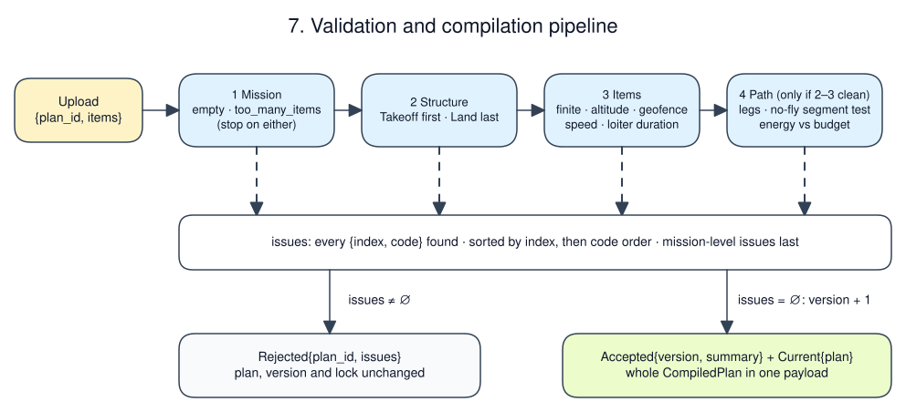
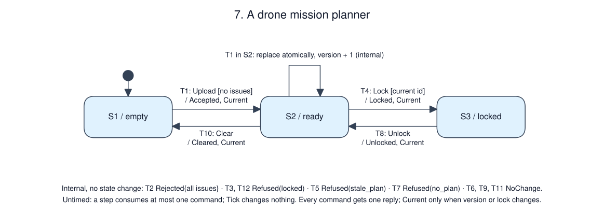

# A drone mission planner

Status: tutorial specification. A reference implementation of this revision
passed A1–A8, including the daemon scenario and replay gate, on 2026-10-18
(msrs a1a8370, cu29 =1.0.0-rc2, statig =0.4.1). That code is not shipped with
the skill; for your implementation, the A-cases are planned tests.

## Purpose and boundary

Validate an uploaded mission and compile it into a flight plan: legs with
distances, durations and an energy estimate. Publish the current plan with a
version so an executor can refer to exactly what it flies. Topology: operator
→ Unix socket → planner → plan consumers (operator, and the executor in
example 08). The planner flies nothing and reads no telemetry. Out of scope:
path search around obstacles, terrain, wind, and the battery's actual state
(the executor checks that before flight).

## Authority and invariants

The operator owns the mission content. A consumer that is flying a plan locks
it; while locked the plan cannot be replaced or cleared.

| ID | Invariant or required outcome | Applies when | Evidence |
|----|-------------------------------|--------------|----------|
| R1 | A plan becomes current only if validation reports no issues | always | A2, A3, A4 |
| R2 | A rejected upload leaves the current plan, version and lock unchanged | always | A5 |
| R3 | A rejection lists every issue, ordered as defined below, not only the first | always | A2 |
| R4 | `Current` is output exactly when the current version or lock changes, and only then | always | A5, A6 |
| R5 | While locked, uploads and clears are rejected `locked` | S3 | A6 |
| R6 | Compilation is a pure function of the items and the configuration; equal uploads give equal bytes | always | A1, A7 |
| R7 | Every command gets exactly one reply in the step that consumes it | always | A1–A6 |

## Configuration

| Name | Value | Units / range | Changed by / when |
|------|-------|---------------|-------------------|
| geofence | radius 100 horizontal; altitude 2–50 | m from home, inclusive | compiled in |
| no-fly zone | centre (0, 50), radius 10 | m, horizontal; boundary allowed | compiled in |
| max items | 64 | items | compiled in |
| speed | (0, 5] | m/s per waypoint | per item |
| loiter | [0, 300] | s | per item |
| climb / descent rate | 1.0 / 0.5 | m/s | compiled in |
| energy rate | 0.05 | % of battery per second of flight | compiled in |
| energy reserve | 25 | %; a plan may use at most 75 | compiled in |
| loop rate | 20 | Hz (`rate_target_hz`) | compiled in |

## Interfaces and data semantics

| ID | Direction / peer | Meaning and fields | Delivery contract |
|----|------------------|--------------------|-------------------|
| I1 | in / operator | `Upload{plan_id, items}`, `Clear` | Line protocol; one command per line, arrival order; malformed lines answered `error parse` by the transport |
| I2 | in / consumer | `Lock{plan_id}`, `Unlock` | same socket in this example; internal in example 08 |
| I3 | out / sender | `Reply`: `Accepted{plan_id, version, summary}`, `Rejected{plan_id, issues}`, `Locked{version}`, `Unlocked`, `Cleared`, `NoChange`, `Refused(reason)` | one per command |
| I4 | out / consumers | `Current{version, locked, plan}`; after a clear, `version` is 0 and `plan` is `None` | on change only (R4) |

Items, in local ENU metres with the origin at home (`z` is height above home):
`Takeoff{z}`, `Waypoint{x, y, z, speed}`, `Loiter{seconds}`, `Land`.
A valid mission is `Takeoff`, then any `Waypoint`/`Loiter` items, then `Land`.
`plan_id` is chosen by the operator; `version` is assigned by the planner,
starts at 1 and increases by one for each accepted upload. Versions restart
with the process; consumers must treat a restart as losing the plan.

## Validation and compilation (algorithm contract)

[Editable Excalidraw pipeline](pipeline.excalidraw)

Validation runs four stages and collects every issue:

1. **Mission:** `empty` if there are no items; `too_many_items` above the
   maximum (no further stages run for either).
2. **Structure:** item 0 must be `Takeoff` (`first_not_takeoff`); `Takeoff` at
   any other index is `takeoff_not_first`; the last item must be `Land`
   (`last_not_land`); `Land` elsewhere is `land_not_last`.
3. **Items:** every number finite (`non_finite`); takeoff `z` within the
   geofence altitudes (`invalid_altitude`); waypoint inside the geofence
   (`outside_geofence`); waypoint speed in range (`invalid_speed`); loiter
   seconds in range (`invalid_duration`). An item with a non-finite number reports
   only `non_finite`; range checks on NaN would add meaningless codes.
4. **Path** (only if stages 2 and 3 found nothing): build legs, then check each
   against the no-fly zone (`crosses_no_fly`) and the total energy against the
   budget (`over_budget`).

Issues are `{index, code}`. Item issues are sorted by index, then by the code
order above; mission-level issues (`empty`, `too_many_items`, `over_budget`)
have no index and come last.

Legs, in item order, starting from home `(0, 0, 0)`:

| Item | Leg | Distance | Duration |
|------|-----|----------|----------|
| `Takeoff{z}` | vertical from home to `(0, 0, z)` | `z` | `z / climb` |
| `Waypoint{x,y,z,s}` | straight line from the previous position | Euclidean 3-D | `distance / s` |
| `Loiter{t}` | stay at the previous position | 0 | `t` |
| `Land` | vertical from the previous position to `z = 0` | previous `z` | `z / descent` |

A leg crosses the no-fly zone when the minimum horizontal distance between its
segment and the zone centre is less than the radius. Vertical legs are points.
Both geofence endpoints inside implies the whole leg is inside, because the
geofence cylinder is convex; the no-fly zone is not, so it needs the segment
test. Totals are sums in item order in f64; `energy_pct = total_time × rate`;
`over_budget` when `energy_pct > 100 − reserve`.

Worked example (A1): `Takeoff{10}`, `Waypoint{30, 40, 10, 5}`, `Loiter{10}`,
`Waypoint{0, 0, 20, 5}`, `Land`. Legs take 10, 10, 10, 10.198039 and 40 s,
cover 10, 50, 0, 50.990195 and 20 m, and total 80.198039 s, 130.990195 m
and 4.009902 %.

## Behavior

[Editable Excalidraw source](behavior.excalidraw)

| State ID / name | Meaning and invariant | Entry / exit effects |
|-----------------|-----------------------|----------------------|
| S1 / empty | No current plan; initial | none |
| S2 / ready | A current plan, not locked | none |
| S3 / locked | A current plan held by a consumer | none |

| ID | Source | Event | Guard | Target | Ordered effects |
|----|--------|-------|-------|--------|-----------------|
| T1 | S1, S2 | Upload | no issues | S2 | version += 1; plan := compiled; `Accepted`; `Current` |
| T2 | S1, S2 | Upload | issues | same, internal | `Rejected{issues}` |
| T3 | S3 | Upload | — | S3, internal | `Refused(locked)` |
| T4 | S2 | Lock | `plan_id` = current | S3 | `Locked{version}`; `Current` |
| T5 | S2, S3 | Lock | `plan_id` ≠ current | same, internal | `Refused(stale_plan)` |
| T6 | S3 | Lock | `plan_id` = current | S3, internal | `NoChange` |
| T7 | S1 | Lock | — | S1, internal | `Refused(no_plan)` |
| T8 | S3 | Unlock | — | S2 | `Unlocked`; `Current` |
| T9 | S1, S2 | Unlock | — | same, internal | `NoChange` |
| T10 | S2 | Clear | — | S1 | `Cleared`; `Current{version: 0, plan: None}` |
| T11 | S1 | Clear | — | S1, internal | `NoChange` |
| T12 | S3 | Clear | — | S3, internal | `Refused(locked)` |

T1 from S2 replaces the plan atomically: consumers never see a partial plan,
because the whole compiled plan travels in one `Current`.

## Ordering and time

Untimed: no rule depends on time. Each step consumes at most one command
(stock `IngressTask`). Steps without a command are `Tick`s, which change nothing
and output nothing. Outputs of one step leave in order: the reply, then
`Current`. A burst of commands queues in the transport channel and is
consumed one per step in arrival order; at 20 Hz a burst of 20 takes one second.

## Failure, recovery and lifecycle

| Condition | Detection / owner | Required state and outputs | Recovery / reset authority |
|-----------|-------------------|----------------------------|----------------------------|
| Invalid mission | validation | `Rejected` with all issues; plan unchanged | operator edits and re-uploads |
| Consumer stops without unlocking | consumer's supervisor | plan stays locked | operator restarts the planner (explicit) |
| Process restart | supervisor | S1, version restarts at 1, no `Current` until an upload | operator re-uploads |
| SIGINT or SIGTERM | runtime | tasks stopped, log flushed, exit 0 | supervisor |

## Implementation mapping and capability gaps

`IngressTask<Inbound>` → `FsmBatchTask<PlannerMachine>` →
`BatchEgressTask<Outbound>`. Validation and compilation are pure store
functions; the statig machine only decides which result applies. A 64-item
plan is one payload of a few kilobytes and is logged once per change, not
every iteration. No msrs changes are required.

## Deployment and operations

20 Hz loop, slab 16 MiB. Idle copperlists are small; each `Current` adds the
plan's encoded size to that step's copperlist.

## Observability and replay

Replay feeds each recorded command as `Message`, and each empty step as
`Tick` at its logged `tov`. Outputs are compared as bincode bytes. The negative
control perturbs one recorded waypoint coordinate of an accepted upload.

## Acceptance scenarios

| ID / requirements | Given | When | Then | Evidence level |
|-------------------|-------|------|------|----------------|
| A1 / T1, R6, R7 | S1 | Upload(7, worked example) | `Accepted{7, version 1}`, then `Current{1, unlocked}` with the legs and totals above (to 1e-6) | unit |
| A2 / T2, R3 | S1 | Upload(8, [Waypoint(150, 0, 10, 7), Takeoff(10), Land, Loiter(400)]) | Rejected with (0 first_not_takeoff), (0 outside_geofence), (0 invalid_speed), (1 takeoff_not_first), (2 land_not_last), (3 last_not_land), (3 invalid_duration) | unit |
| A3 / R1 | S1 | Upload with a leg from (−40, 50, 10) to (40, 50, 10); then from (−40, 60, 10) to (40, 60, 10) | first: `crosses_no_fly` at the second waypoint; second: accepted (tangent) | unit |
| A4 / R1 | S1 | Upload with six `Loiter{300}`; upload with 65 items | `over_budget` (no index); `too_many_items` only | unit |
| A5 / R2, R4 | S2 at version 1 | invalid upload; valid upload | Rejected, no `Current`; then `Accepted` version 2 and `Current` | unit |
| A6 / T4–T12, R5 | S2 at version 1, plan 7 | Lock(6); Lock(7); Lock(7); Upload; Clear; Unlock; Clear | `stale_plan`; `Locked` + `Current`; `NoChange`; `Refused(locked)` twice; `Unlocked` + `Current`; `Cleared` + `Current(None)` | unit |
| A7 / R6 | two cold machines | the same upload | byte-identical outputs | unit |
| A8 / all | daemon | upload, invalid upload, 64-item upload, lock, unlock, clear | replies as above; SIGTERM exits 0; replay equal including `Tick` steps; negative control fails; log bytes per `Current` measured | daemon and log |

## Open decisions

| Decision / assumption | Owner | Blocks implementation? | Resolution / evidence needed |
|-----------------------|-------|------------------------|------------------------------|
| Energy model is a constant rate | vehicle owner | no for tutorial | measured consumption by phase and wind |
| A crashed consumer leaves the plan locked | mission owner | no | lock lease with expiry if consumers are separate processes |
