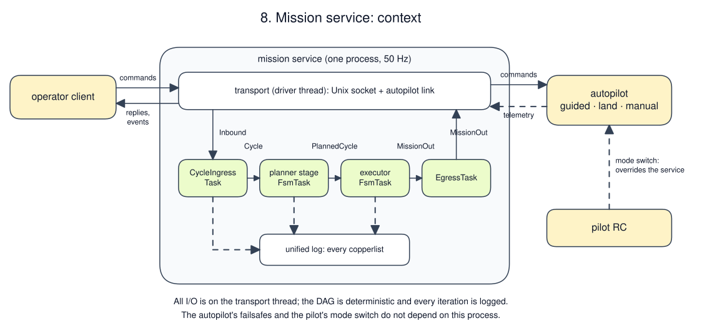
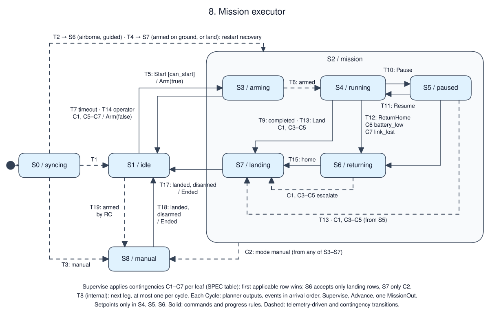

# A drone mission service

Status: tutorial specification. A reference implementation of this revision
passed A1–A11, including the daemon scenario and replay gate, on 2026-10-18
(msrs a1a8370, cu29 =1.0.0-rc2, statig =0.4.1). That code is not shipped with
the skill; for your implementation, the A-cases are planned tests.

This example combines examples 05–07: the planner of 07 becomes the first
stage of one service, and an executor that arms (as in 05) and streams
setpoints (as in 06) flies the plan. New here: two FSM stages in one Copper
DAG, a plan snapshot instead of a lock, mission pause and resume,
contingencies with precedence and escalation, and recovery after a restart
in flight.

## Purpose and boundary

Accept missions from an operator, fly one to completion on a single drone, and
return or land the drone when a contingency occurs. [Context
drawing](context.excalidraw):

Everything runs on the companion computer. The autopilot is in `guided` mode
for flight, follows streamed position setpoints, holds position when the
stream stops, and lands itself in its `land` mode. Out of scope: obstacle
avoidance, terrain, wind estimation, multi-vehicle missions and a planned
return path (see open decisions). The autopilot owns attitude control and its
own failsafes, which keep working if this process stops.

## Authority and invariants

The pilot's RC mode switch overrides this service. The operator owns mission
content and mission commands. The autopilot's telemetry is authoritative for
position, mode, armed and landed. The executor owns the plan snapshot it is
flying; uploads during a mission change only the next mission.

| ID | Invariant or required outcome | Applies when | Evidence |
|----|-------------------------------|--------------|----------|
| R1 | A mission flies exactly the plan snapshot taken at `Start`; later uploads do not change it | S2 | A3 |
| R2 | A setpoint is output in a cycle if and only if the resulting state is S4, S5 or S6 | always | A2, A6, A8 |
| R3 | Contingencies follow the precedence table; they only escalate (return → land), never de-escalate, and the operator cannot resume after one | S2 | A5, A6, A7 |
| R4 | In S8 the service sends no autopilot command and no setpoint | S8 | A8 |
| R5 | `Arm(false)` is sent only when telemetry reports landed, or while arming with telemetry still reporting disarmed | always | A4, A2 |
| R6 | Every operator command except `Heartbeat` gets exactly one reply in the cycle in which it is drained | always | A1, A4 |
| R7 | Every `Started` mission is followed by exactly one `Ended{result}`, emitted when telemetry reports landed and disarmed (or when arming is abandoned). `Ended` is emitted exactly on each return to S1 from S2 or S8, so recoveries end with one too | S2, S8 | A2, A5, A7, A8 |
| R8 | After a restart the service adopts what telemetry reports and never commands arming; a drone found flying in `guided` returns home | startup | A9 |

## Configuration

| Name | Value | Units / range | Changed by / when |
|------|-------|---------------|-------------------|
| cycle period | 20 nominal | ms (`rate_target_hz: 50`) | compiled in |
| telemetry stale | 500 | ms since the cycle that drained the last telemetry | compiled in |
| arm timeout | 2000 | ms | compiled in |
| waypoint tolerance | 0.5 | m, 3-D, inclusive | compiled in |
| return altitude / speed | 15 / 4 | m (at least the current height) / m/s | compiled in |
| home tolerance | 1.0 | m horizontal, inclusive | compiled in |
| battery low / critical | 25 / 15 | %, below triggers | compiled in |
| start reserve | 25 | %: start needs battery ≥ plan energy + reserve | compiled in |
| link timeout | 2000 | ms since the last operator line | compiled in |
| geofence breach | radius > 100 or height > 50 | m from home | compiled in |
| planning | as example 07 | — | compiled in |

## Interfaces and data semantics

| ID | Direction / peer | Meaning and fields | Delivery contract |
|----|------------------|--------------------|-------------------|
| I1 | in / operator | planner commands `Upload`, `Clear` (as 07) | line protocol, arrival order; malformed lines answered by the transport |
| I2 | in / operator | `Op{id, kind}`: `Start{plan_version}`, `Pause`, `Resume`, `ReturnHome`, `Land`, `Heartbeat` | same socket and order; any operator line refreshes the link |
| I3 | in / autopilot | `Telem{x, y, z, mode, armed, landed, battery_pct}`, about 20 Hz | latest value; `mode` ∈ `guided`, `land`, `manual`; non-finite positions are discarded |
| I4 | out / autopilot | `Arm(bool)`, `LandMode`, and a `Setpoint{x, y, z, speed}` stream | requests; completion is observed in telemetry |
| I5 | out / operator | planner replies and `Current` (as 07); `Reply{id, result}`; mission events `Started{version}`, `Leg{index}`, `Paused`, `Resumed`, `Returning(reason)`, `Landing(reason)`, `Manual`, `Ended{result}`; `Status` on change | in occurrence order within a cycle |

Frame and clock as examples 06 and 07: local ENU metres from home; cu29
`RobotClock` via `CycleIngressTask`, events received at their cycle's `now_ns`.

## Behavior

[Editable Excalidraw source](behavior.excalidraw) · [contingency sequence](sequence.excalidraw)

The planner stage is example 07's machine without its lock: S1/S2 of 07, T1,
T2, T10, T11. The executor:

| State ID / name | Meaning and invariant | Entry / exit effects |
|-----------------|-----------------------|----------------------|
| S0 / syncing | No telemetry since start; initial | none |
| S1 / idle | On the ground, disarmed, no mission | none |
| S2 / mission | Composite of S3–S7; a mission or recovery is in progress | none |
| S3 / arming | `Arm(true)` sent; telemetry still disarmed | Entry: `requested_at := now` |
| S4 / running | Flying leg `leg` of the snapshot | none |
| S5 / paused | Holding at `hold`; `leg` is kept | Entry: `hold :=` the latest recorded position when `Pause` is handled |
| S6 / returning | Flying to `(0, 0, return_z)` | Entry: `return_z := max(z, 15)` |
| S7 / landing | Autopilot in land mode; waiting for landed and disarmed | Entry: `LandMode` |
| S8 / manual | Pilot has control; service passive | Entry: `Manual` event |

| ID | Source | Event | Guard | Target | Ordered effects |
|----|--------|-------|-------|--------|-----------------|
| T1 | S0 | Telem | landed, disarmed | S1 | — |
| T2 | S0 | Telem | airborne, `guided` | S6 | reason `restart` |
| T3 | S0 | Telem | `manual` | S8 | reason `restart` |
| T4 | S0 | Telem | otherwise (armed on ground, or `land`) | S7 | reason `restart` |
| T5 | S1 | Start | `can_start` | S3 | `Reply Accepted`; snapshot := current plan; `Started{version}`; `Arm(true)` |
| T6 | S3 | Telem | armed | S4 | `leg := 0`; `Leg{0}` |
| T7 | S3 | Advance | `now - requested_at ≥ arm timeout` | S1 | `Arm(false)`; `Ended{Aborted(arm_timeout)}` |
| T8 | S4 | Advance | leg done, next leg is not `Descend` | S4, internal | `leg += 1`; `Leg{leg}` |
| T9 | S4 | Advance | leg done, next leg is `Descend` | S7 | `leg += 1`; `Leg{leg}`; reason `completed` |
| T10 | S4 | Pause | — | S5 | `Reply Accepted`; `Paused` |
| T11 | S5 | Resume | — | S4 | `Reply Accepted`; `Resumed`; restart leg `leg` |
| T12 | S4, S5 | ReturnHome | — | S6 | `Reply Accepted`; reason `operator` |
| T13 | S4, S5, S6 | Land | — | S7 | `Reply Accepted`; reason `operator` |
| T14 | S3 | ReturnHome, Land | — | S1 | `Reply Accepted`; `Arm(false)`; `Ended{Aborted(operator)}` |
| T15 | S6 | Advance | horizontal distance to home ≤ tolerance | S7 | reason kept; a return that starts within the tolerance lands in the same cycle |
| T16 | S7 | Advance | landed, armed, disarm not yet sent | S7, internal | `Arm(false)` |
| T17 | S7 | Advance | landed, disarmed | S1 | `Ended{result}` |
| T18 | S8 | Advance | landed, disarmed | S1 | `Ended{Aborted(override)}` |
| T19 | S1 | Telem | armed or not landed | S8 | reason `external` (the pilot armed by RC) |
| C1–C7 | S3–S7 | Supervise | contingency table | per table | per table |

A leg is done when: `Climb` or `Fly`, the position is within the waypoint
tolerance of its end; `Loiter`, `now - leg_started ≥ duration`. At most one
leg completes per cycle. Resume restarts the current leg: a loiter starts its
full duration again. The result of `Ended` is `Completed` when the landing
reason is `completed`, otherwise `Aborted(reason)`.

`can_start` checks, in order: a current plan (`no_plan`); `plan_version` equals
its version (`stale_plan`); telemetry fresh (`telem_stale`); landed and disarmed
(`not_on_ground`); mode `guided` (`not_guided`); battery ≥ plan energy + reserve
(`low_battery`). In S0 every command is rejected `no_telemetry`.

Replies that change nothing: `Pause` in S5 and `ReturnHome` in S6 are
`NoChange`; `Land` in S7 is `NoChange`. Rejections: `Start` in S2 or S8 is
`busy`; `Pause`, `Resume` or `ReturnHome` outside S4/S5 is `not_flying`,
except in S6 after a contingency, which is `contingency`; anything in S8 is
`manual`; `Resume` in S4 is `NoChange`.

### Contingencies

Evaluated once per cycle in `Supervise`, in this precedence. The first row
whose condition holds **and** that applies to the current leaf wins; a row that
does not apply to the leaf does not block lower rows.

| ID | Condition | S3 arming | S4 running, S5 paused | S6 returning | S7 landing |
|----|-----------|-----------|-----------------------|--------------|------------|
| C1 | telemetry stale | S1, `Arm(false)`, `Ended{Aborted(telem_lost)}` | S7 `telem_lost` | S7 `telem_lost` | — |
| C2 | mode `manual` | S8 | S8 | S8 | S8 |
| C3 | mode `land` (autopilot failsafe) | — | S7 `autopilot_land` | S7 `autopilot_land` | — |
| C4 | geofence breach | — | S7 `geofence` | S7 `geofence` | — |
| C5 | battery < critical | S1, `Arm(false)`, `Ended{Aborted(battery)}` | S7 `battery_critical` | S7 `battery_critical` | — |
| C6 | battery < low | S1, `Arm(false)`, `Ended{Aborted(battery)}` | S6 `battery_low` | — | — |
| C7 | link lost | S1, `Arm(false)`, `Ended{Aborted(link_lost)}` | S6 `link_lost` | — | — |

Escalation is built into the columns: S6 accepts only landing rows, S7 only
C2. Telemetry loss lands rather than returns, because the service can no
longer observe the flight; the autopilot's land mode needs no position from
this service.

## Ordering and time

The planner stage consumes `Upload` and `Clear` from the cycle in arrival
order and forwards the rest unchanged, with its replies and any new `Current`.
The executor then runs one logical step per cycle:

1. Planner outputs: a new `Current` replaces the executor's latest plan copy.
   A `Start` later in the same cycle can therefore name the version that an
   `Upload` earlier in the same cycle created.
2. Events in arrival order: telemetry is recorded (T1–T6 apply); operator
   lines refresh the link; commands are replied to. A command is checked
   against the telemetry drained before it in the cycle, not after it.
3. `Supervise` at `now_ns`: contingencies C1–C7.
4. `Advance` at `now_ns`: T7–T9, T15–T18.
5. One `MissionOut{autopilot, setpoint, events, planner, status}`.

As in example 06, `Supervise` and `Advance` are separate internal events so a
leaf's progress rule never hides a contingency. A drone that reaches its last
waypoint in the cycle where the battery crosses low returns home.

| Requirement | Bound / clock / measurement points | On violation |
|-------------|------------------------------------|--------------|
| Setpoint stream | every cycle in S4–S6; gap ≤ 40 ms | reported from the log |
| Contingency reaction | in the first cycle whose state shows the condition | — |
| Step budget | executor `process_time` ≤ 1 ms with a 64-leg plan | reported from the log |

## Failure, recovery and lifecycle

| Condition | Detection / owner | Required state and outputs | Recovery / reset authority |
|-----------|-------------------|----------------------------|----------------------------|
| Contingency C1–C7 | executor | per table; `Ended` after landing | operator starts a new mission |
| Process crash in flight | supervisor; autopilot | setpoints stop; autopilot holds, then its own failsafe | restart: R8 (T2 returns home) |
| Restart on the ground, armed | T4 | S7 disarms once landed telemetry is seen | automatic |
| Autopilot left in `land` mode after landing | `can_start` (`not_guided`) | S1; Start rejected | operator or pilot selects `guided`; this service sends no mode requests other than `LandMode` |
| SIGINT or SIGTERM | runtime | tasks stopped, log flushed, exit 0; autopilot holds | supervisor |

A planned shutdown in flight should first return or land the drone; the
service does not delay SIGTERM to do so (open decision).

## Implementation mapping and capability gaps

DAG: `CycleIngressTask<Inbound>` → `FsmTask<PlannerStage>` →
`FsmTask<MissionMachine>` → `EgressTask<MissionOut>`. Both stages emit every
cycle, so neither ever ticks. The planner stage wraps example 07's
`PlannerMachine`; its output carries the plan only when it changes, so the log
holds one copy per change rather than one per cycle.

Why a snapshot instead of 07's lock: a Copper DAG is acyclic within an
iteration, so the executor cannot lock the planner in the same step, and a
feedback edge would apply a lock one cycle late. Copying the plan at `Start`
gives the same guarantee (R1) without the edge.

statig: `mission` is a superstate for shared replies (`Start` is `busy`).
Contingencies depend on the leaf, so each leaf passes its column to one shared
`supervise(leaf)` function instead of relying on the superstate, which does
not know the active leaf. Leg index, hold point and return height are store
data; resume history is the stored `leg`, not statig history.

## Deployment and operations

Supervised by systemd with a fixed working directory; 50 Hz; slab 16 MiB.

## Observability and replay

The log records the cycle, the planner stage's output, and the executor's
output. The gate replays three ways and requires byte equality for each:
the planner stage from recorded cycles, the executor from the recorded planner
output, and both chained from recorded cycles. Negative control: perturb one
telemetry battery value below the low threshold during a mission.

## Acceptance scenarios

Telemetry "ok on ground" is landed, disarmed, `guided`, battery 90.

| ID / requirements | Given | When | Then | Evidence level |
|-------------------|-------|------|------|----------------|
| A1 / T5, R6 | S1, plan v1 | Start(v2); Start(v1) | `Rejected(stale_plan)`; `Accepted`, `Started{1}`, `Arm(true)` | unit |
| A2 / T6, T8, T9, T16, T17, R2, R7 | S3, plan of 07's worked example | armed; positions reach each leg end; loiter 10 s; land; landed; disarmed | `Leg{0..4}` in order; setpoints only in S4; `LandMode` on S7 entry; `Arm(false)` after landed; `Ended{Completed}` | unit |
| A3 / R1 | S4 on plan v1 | Upload accepted as v2 | `Current{2}` forwarded; snapshot still v1 | unit |
| A4 / T7, T14, R5 | S3 | no armed telemetry for 2000 ms; separately ReturnHome | `Arm(false)`, `Ended{Aborted(arm_timeout)}`; `Ended{Aborted(operator)}` | unit |
| A5 / C6, C5, R3 | S4 in a loiter | battery 24; then Resume; then battery 14 | S6 `battery_low`; Resume `Rejected(contingency)`; S7 `battery_critical` | unit |
| A6 / C1–C7 precedence | S4 | one cycle with telemetry: manual, battery 10, outside fence | S8 (C2 wins over C4 and C5); no setpoint | unit |
| A7 / C7 | S4, operator silent | 2000 ms without operator lines | S6 `link_lost`; later `Ended{Aborted(link_lost)}` after landing | unit |
| A8 / R2, R4, T18 | S4 | mode manual; then landed and disarmed | S8, no outputs to the autopilot while in S8; S1 with `Ended{Aborted(override)}` | unit |
| A9 / T2–T4, R8 | cold | first telemetry airborne `guided`; separately `manual`; separately armed on ground | S6 `restart`; S8; S7 then `Arm(false)` | unit |
| A10 / pause | S4 on a fly leg | Pause; Resume | S5 holds at the pause position; S4 restarts the same leg | unit |
| A11 / all | daemon with simulated drone | upload, start, complete; start, pause, resume, battery drain to low then critical; restart while flying | event sequences above; setpoint gap ≤ 40 ms; SIGTERM exits 0; three-way replay equal; negative control fails | daemon and log |

Additional checks: a state × event table over the nine states and every
operator command and contingency, asserting R2, R4, R5 and R6; a seeded
randomized flight asserting R2–R7.

## Open decisions

| Decision / assumption | Owner | Blocks implementation? | Resolution / evidence needed |
|-----------------------|-------|------------------------|------------------------------|
| Return home is a straight line and may cross the no-fly zone | mission owner | no for tutorial; yes for production | plan return paths with example 07's validator |
| SIGTERM in flight does not land first | robot owner | no for tutorial | supervisor runs ReturnHome and waits before stopping |
| Operator identity is not authenticated | robot owner | no for tutorial | authenticated transport |
